# LibRedirect Mobile

LibRedirect Mobile is an Android app that routes links from large online services to privacy-friendly frontends. It can redirect links from services such as YouTube, Reddit, and X/Twitter to compatible Invidious, Redlib, or alternative instances, and open them either in your preferred external browser or in the app's built-in multi-tab browser.

Routing rules live in a declarative manifest. This design lets the service catalog evolve without adding service-specific routing code to the Android client.

## Screenshots

All screenshots below were captured from LibRedirect Mobile **v1.3.11** (Build 20). Expand any section to view the images.

<details>
<summary><strong>Home &amp; Service Catalog</strong> (6 screenshots)</summary>

<table>
  <tr>
    <td align="center" valign="top">
      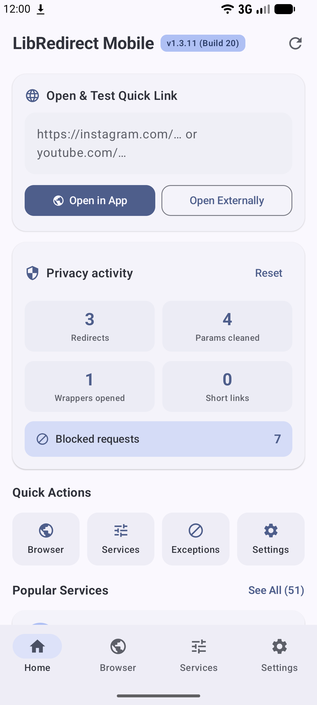<br />
      <sub><b>Home (Light)</b><br />Quick link tester, privacy activity counters, and quick actions</sub>
    </td>
    <td align="center" valign="top">
      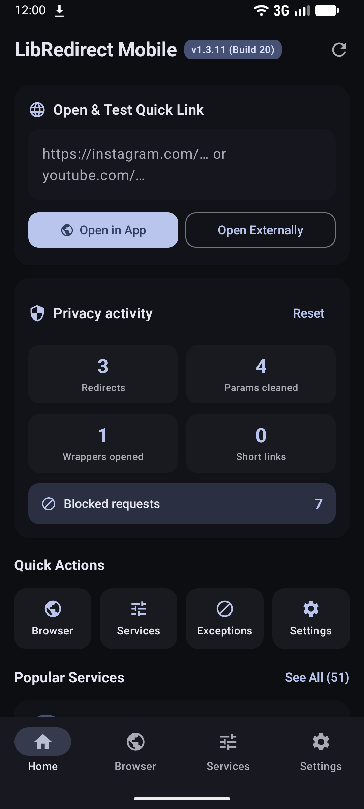<br />
      <sub><b>Home (Dark)</b><br />Adaptive dark theme with live stats and quick navigation</sub>
    </td>
    <td align="center" valign="top">
      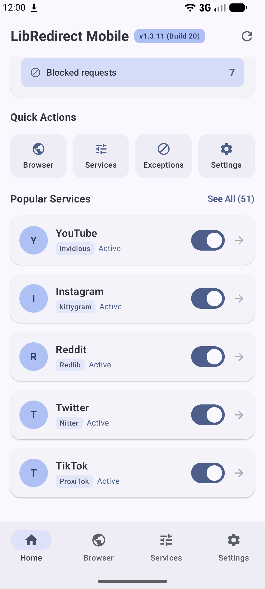<br />
      <sub><b>Popular Services</b><br />Featured frontend cards highlighted on the Home dashboard</sub>
    </td>
  </tr>
  <tr>
    <td align="center" valign="top">
      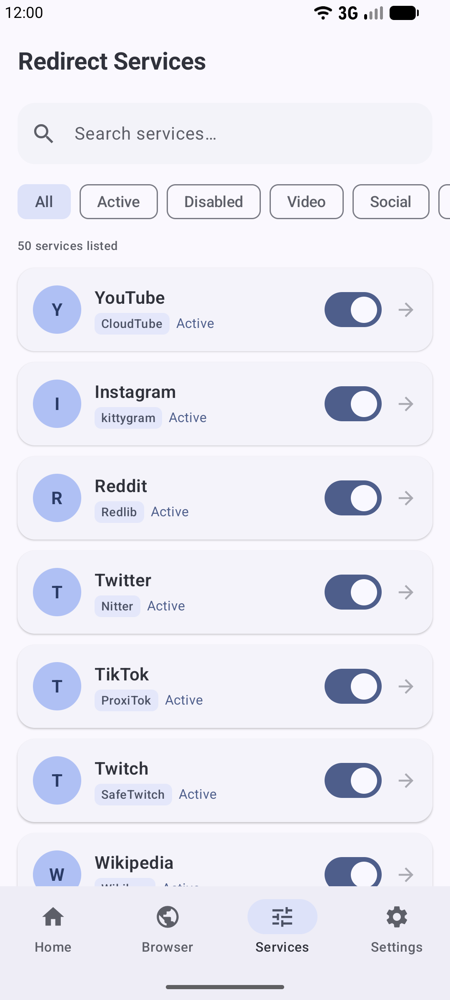<br />
      <sub><b>Redirect Services</b><br />Searchable catalog with status and category filters</sub>
    </td>
    <td align="center" valign="top">
      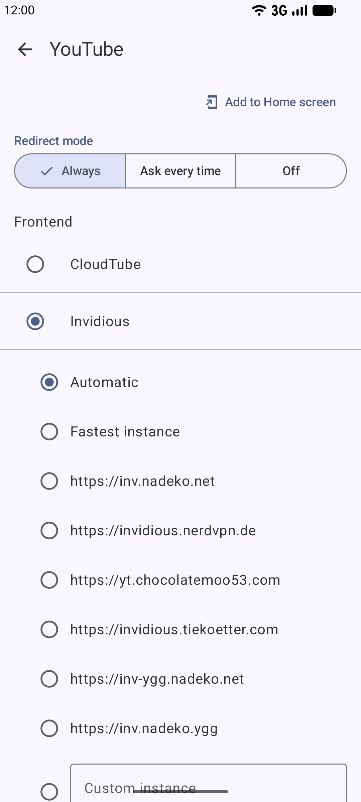<br />
      <sub><b>Service Detail</b><br />Redirect mode, frontend choice, instances, and custom URL</sub>
    </td>
    <td align="center" valign="top">
      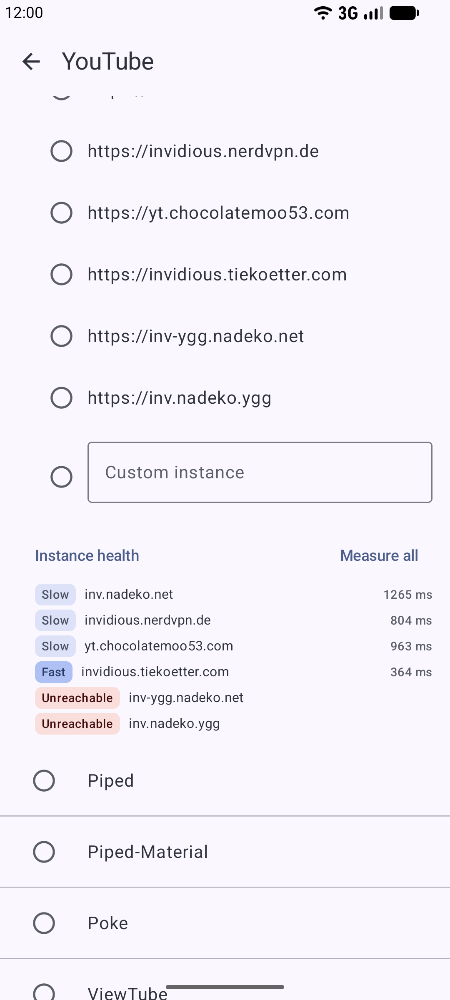<br />
      <sub><b>Instance Health</b><br />On-demand latency probes and reachability indicators</sub>
    </td>
  </tr>
</table>

</details>

<details>
<summary><strong>Built-in Multi-Tab Browser</strong> (11 screenshots)</summary>

<table>
  <tr>
    <td align="center" valign="top">
      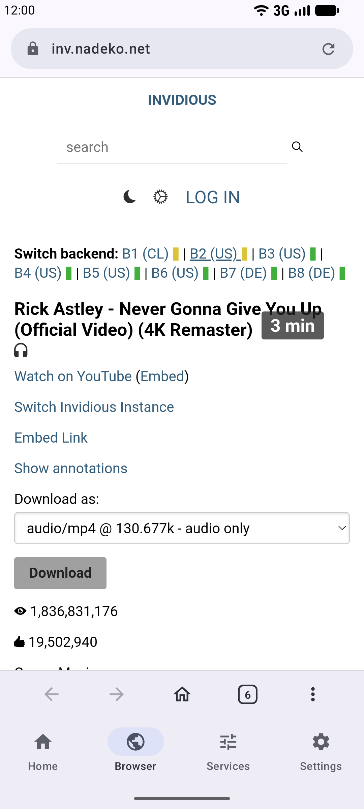<br />
      <sub><b>Routed Browsing</b><br />YouTube link automatically routed to an Invidious frontend</sub>
    </td>
    <td align="center" valign="top">
      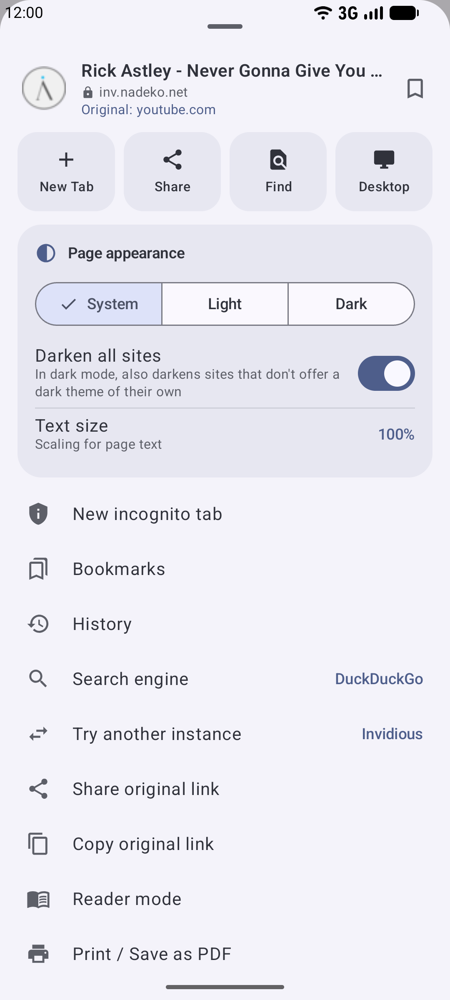<br />
      <sub><b>Browser Menu</b><br />Page theme, text zoom, original link actions, reader, and print</sub>
    </td>
    <td align="center" valign="top">
      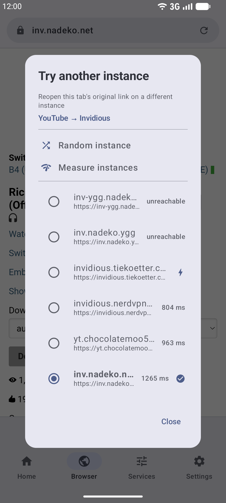<br />
      <sub><b>Try Another Instance</b><br />Quick instance switcher with live latency measurement</sub>
    </td>
    <td align="center" valign="top">
      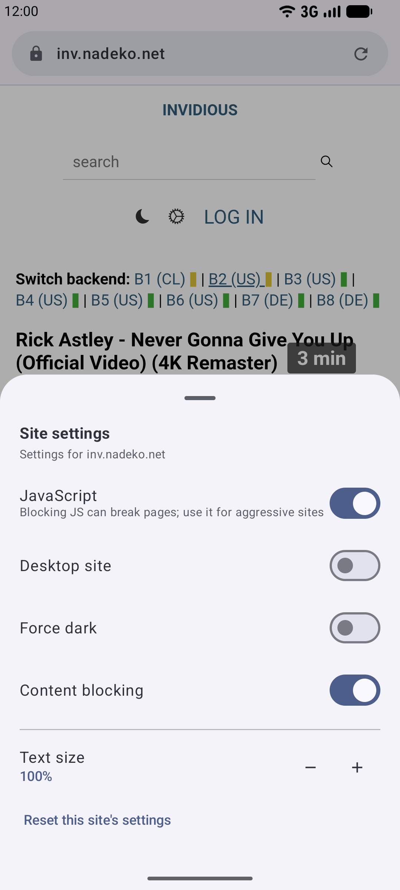<br />
      <sub><b>Site Settings</b><br />Per-host JavaScript, desktop mode, dark mode, and blocking</sub>
    </td>
  </tr>
  <tr>
    <td align="center" valign="top">
      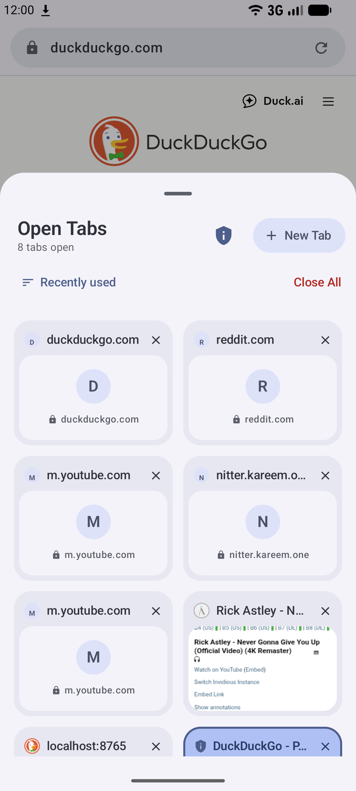<br />
      <sub><b>Open Tabs</b><br />Live preview cards, incognito tabs, and Close All action</sub>
    </td>
    <td align="center" valign="top">
      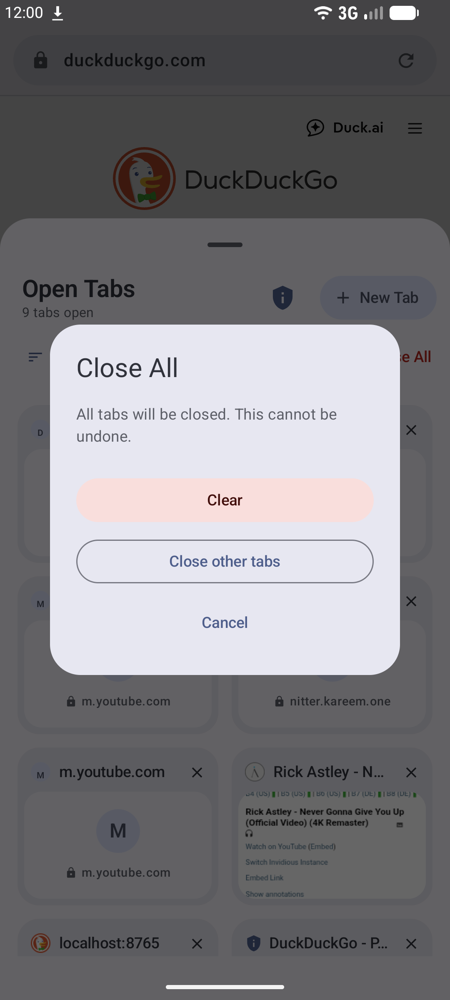<br />
      <sub><b>Close All Dialog</b><br />Clear all tabs or keep the active tab with stacked actions</sub>
    </td>
    <td align="center" valign="top">
      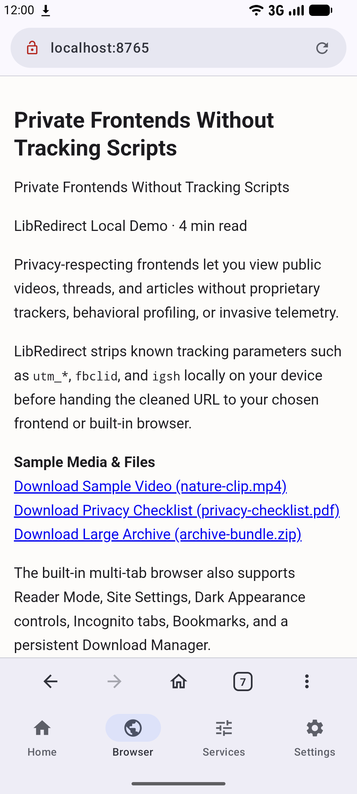<br />
      <sub><b>Reader Mode</b><br />Clean distraction-free typography for readable articles</sub>
    </td>
    <td align="center" valign="top">
      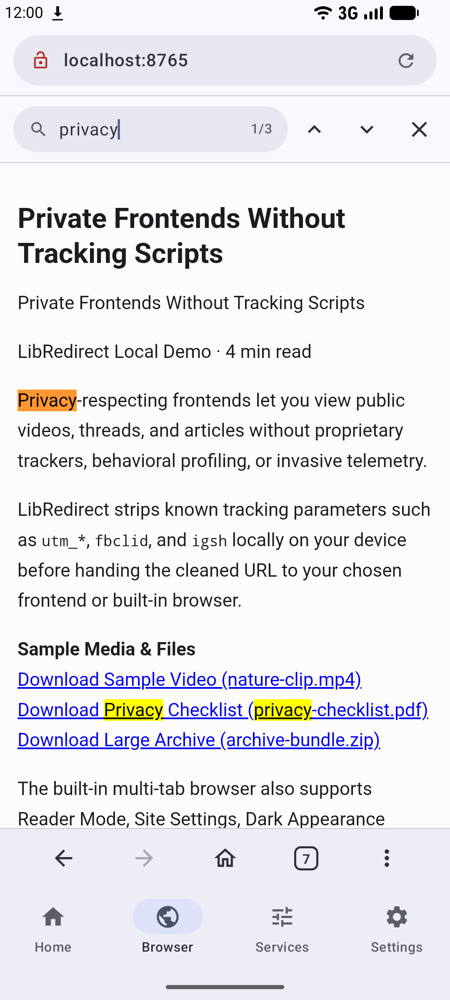<br />
      <sub><b>Find in Page</b><br />In-page query bar with match count and highlighted hits</sub>
    </td>
  </tr>
</table>

<table>
  <tr>
    <td align="center" valign="top">
      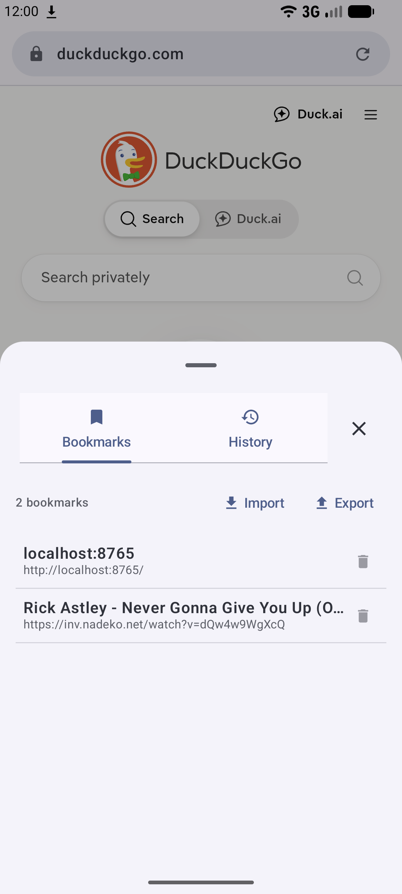<br />
      <sub><b>Bookmarks</b><br />Saved pages with JSON import and export</sub>
    </td>
    <td align="center" valign="top">
      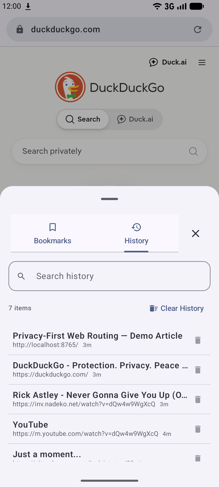<br />
      <sub><b>History</b><br />Searchable browsing log with one-tap Clear History</sub>
    </td>
    <td align="center" valign="top">
      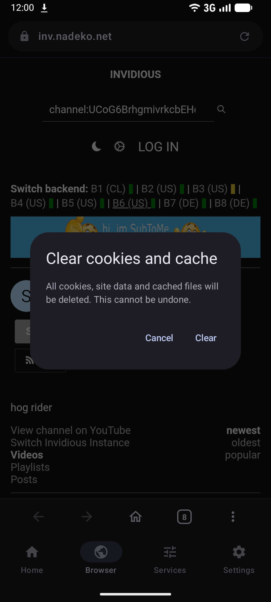<br />
      <sub><b>Clear Cookies &amp; Cache</b><br />Per-site data cleanup dialog (shown in Dark Mode)</sub>
    </td>
  </tr>
</table>

</details>

<details>
<summary><strong>Download Manager</strong> (2 screenshots)</summary>

<table>
  <tr>
    <td align="center" valign="top">
      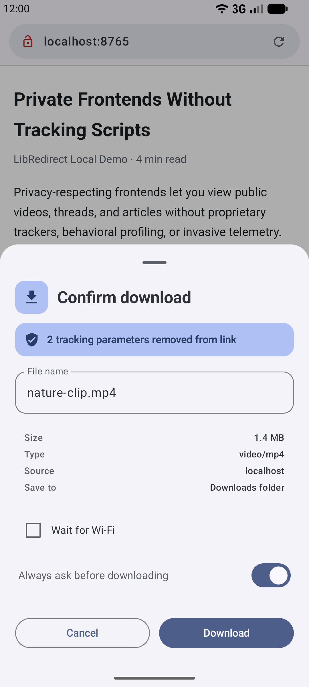<br />
      <sub><b>Pre-Download Prompt</b><br />Tracker stripping summary, editable filename, Wi-Fi-only toggle</sub>
    </td>
    <td align="center" valign="top">
      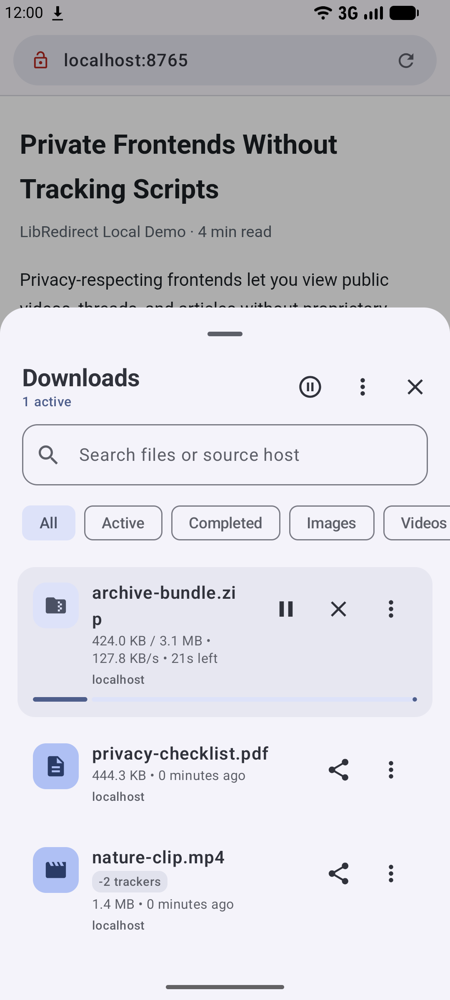<br />
      <sub><b>Downloads Sheet</b><br />Live progress, speed/ETA, type filters, Pause all, and tracker chip</sub>
    </td>
  </tr>
</table>

</details>

<details>
<summary><strong>Settings, Custom Rules &amp; Diagnostics</strong> (8 screenshots)</summary>

<table>
  <tr>
    <td align="center" valign="top">
      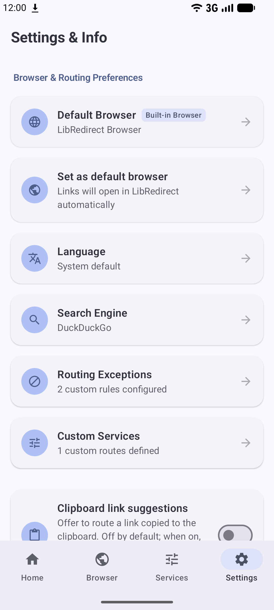<br />
      <sub><b>Settings &amp; Info</b><br />Default browser, language, search engine, and clipboard tools</sub>
    </td>
    <td align="center" valign="top">
      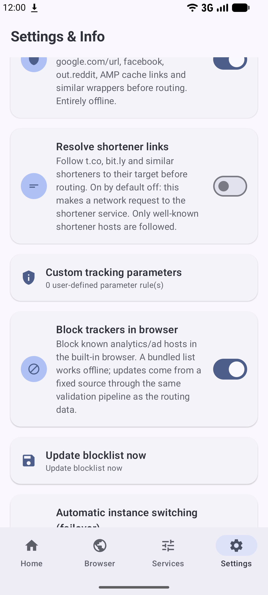<br />
      <sub><b>Privacy &amp; Failover</b><br />Short link resolution, custom params, blocklists, and failover</sub>
    </td>
    <td align="center" valign="top">
      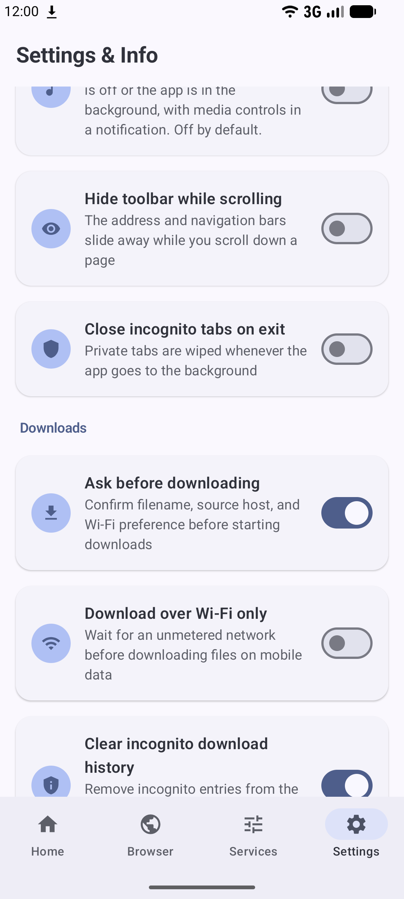<br />
      <sub><b>Browser &amp; Downloads</b><br />Toolbar auto-hide, incognito cleanup, and download defaults</sub>
    </td>
    <td align="center" valign="top">
      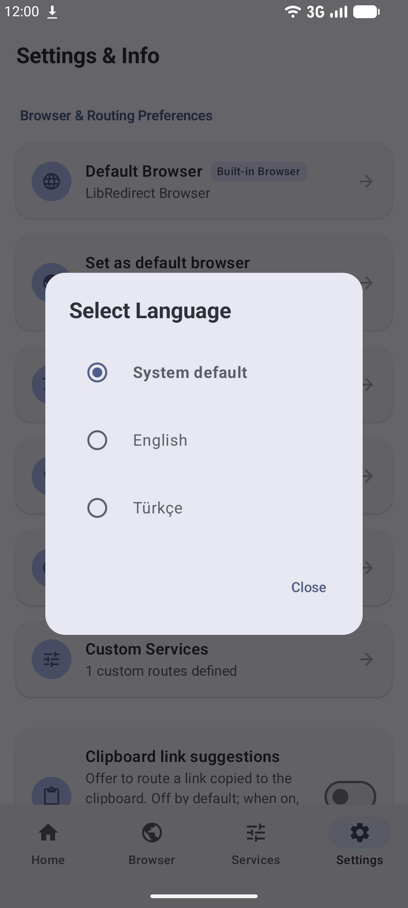<br />
      <sub><b>Language Picker</b><br />System default, English, and Türkçe localization</sub>
    </td>
  </tr>
  <tr>
    <td align="center" valign="top">
      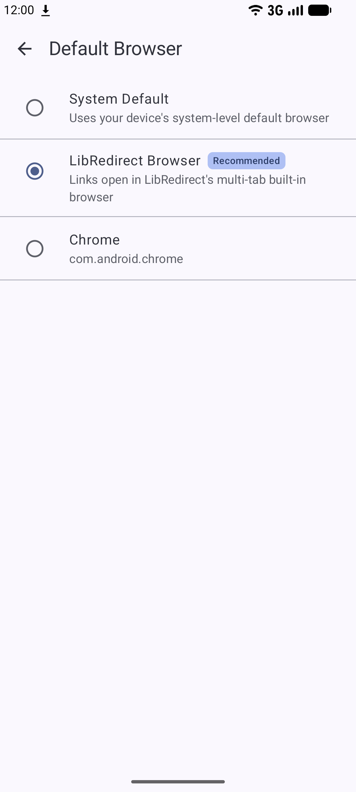<br />
      <sub><b>Default Browser</b><br />Choose between the built-in browser and installed apps</sub>
    </td>
    <td align="center" valign="top">
      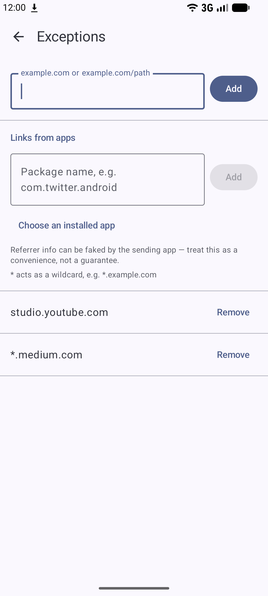<br />
      <sub><b>Exceptions</b><br />Host/wildcard bypass rules and links opened from other apps</sub>
    </td>
    <td align="center" valign="top">
      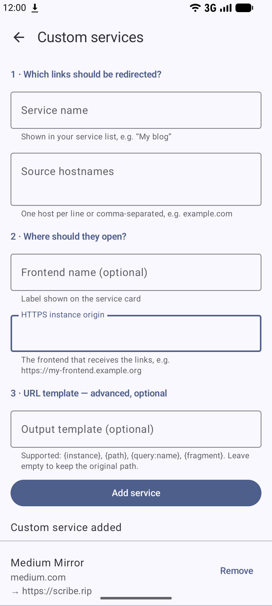<br />
      <sub><b>Custom Services</b><br />3-step custom domain-to-frontend rule builder</sub>
    </td>
    <td align="center" valign="top">
      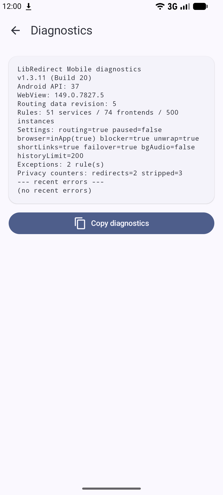<br />
      <sub><b>Diagnostics</b><br />Local app/WebView info, routing counts, flags, and error log</sub>
    </td>
  </tr>
</table>

</details>

## Features

### Routing

- **Privacy-focused routing**: Redirect eligible links without accounts, analytics, or a backend.
- **Tracking-parameter stripping**: Well-known tracking parameters (`utm_*`, `fbclid`, `gclid`, YouTube's `si`, Amazon's `ref_*`, X's `s`/`t`, …) are removed before a link is opened — including links that are not routed at all. User exceptions keep their URLs byte-for-byte intact, and you can add your own global or per-host rules.
- **Wrapper & AMP unwrapping**: Redirect wrappers (`google.com/url?q=`, `l.facebook.com`, `out.reddit.com`, AMP caches, …) are resolved entirely offline before routing (on by default).
- **Short-link resolution (opt-in, off by default)**: When enabled, links from a fixed allowlist of shorteners (t.co, bit.ly, …) are followed with HTTPS requests before routing. This is the one feature that makes routing touch the network — see [SECURITY.md](SECURITY.md).
- **Offline-first routing**: Route links locally — apart from the opt-in short-link feature, routing never makes a network request.
- **Smart instance selection**: Automatic mode is latency-weighted random over instances that are not in a failure cooldown; a **Fastest** mode always picks the lowest-latency measured instance; Pinned and Custom modes behave as before. Failed loads cool instances down for 10 minutes.
- **Automatic failover**: When a routed page fails (network error, 5xx/429, bot interstitial), the browser retries on the next healthy instance (up to twice) before offering the original site.
- **Instance health panel**: The service detail screen lists every instance with Fast/Slow/Unreachable/Not-measured/Cooldown badges, a "measure all" action, and an optional daily background measurement.
- **Per-service control**: Enable or disable individual services, choose the frontend for each service, set a service to **ask every time**, and pick an instance (Automatic / Fastest / Pinned / Custom).
- **Routing exceptions**: Host, host/path, and wildcard (`*.example.com`) rules, plus per-app exclusions based on the sending app's referrer (a convenience, not a security guarantee).
- **Temporary pause**: Pause routing for 15 minutes, an hour, or until you turn it back on — from the Home card or the Quick Settings tile.
- **"Why?" explainer**: The Home quick-link tester shows a structured trace: matched rule, chosen frontend/instance, selection mode, stripped parameters, or the exact reason a link passed through.
- **Original-link share/copy**: The browser menu can share or copy the pre-redirect URL, computing it from frontend URLs where safely reversible.
- **Custom services**: Add local services with source hostnames and an HTTPS instance or an output template supporting `{instance}`, `{path}`, `{query:name}`, and `{fragment}`.
- **Safe fallback**: Open the original URL when routing fails for an eligible link (fail-open); malformed or unsupported-scheme input is never opened at all.
- **Redirect-loop prevention**: When handing a link to an external browser, the app can never be chosen as its own target.
- **Quick access**: A Quick Settings tile and a home-screen widget toggle routing (the widget also routes the clipboard link); launcher shortcuts open a new browser tab or the services list.

### Built-in browser

- **Multi-tab browsing**: A tabbed WebView browser ("LibRedirect Browser") that receives routed links directly, with a tab switcher (sort, groups, close all / close other tabs), navigation controls, and a combined URL/search address bar. Open tabs survive process death; stale tabs can auto-close.
- **Content blocking**: Well-known tracker/ad hosts are blocked per-request (on by default). A bundled list works offline; updates come from one fixed HTTPS source through the same validation pipeline as the routing data.
- **Per-site settings**: JavaScript, desktop mode, text size, forced dark rendering, and content blocking per host, from the address bar's security icon.
- **Picture-in-picture**: Fullscreen video continues in a PiP window when you leave the app.
- **Background audio (opt-in)**: A media foreground service keeps audio playing with play/pause/stop notification controls.
- **Reader mode**: A locally packaged, dependency-free article extractor renders pages in a clean, theme-aware view.
- **Start page**: New tabs offer a grid of bookmarks and frequently visited sites.
- **Search engines**: Choose DuckDuckGo, SearXNG, Brave Search, Google, Startpage, or add a custom engine via a `%s` URL template.
- **Bookmarks and history**: Local bookmark list with standard HTML and JSON import/export; history limit configurable (off / 50 / 200 / 500 / 1000).
- **Built-in download manager**: OkHttp-backed transfer engine running in a foreground service with live progress, speed, and ETA notifications (`Pause all` / `Cancel`), HTTP `Range` pause/resume, failure categorization and retry, **Wi-Fi only** scheduling (resumes automatically on unmetered networks or via manual override), and `http(s):` / `data:` / `blob:` support.
- **Pre-download confirmation & smart filename resolution**: A configurable confirmation sheet (also forced for executables/installers) supports renaming files, live `Range`-probed size and MIME previews, and stripped tracking-parameter counts. Proxy query URLs (e.g. `/mediaproxy?url=...`), `Content-Disposition` headers, server `Content-Type`, and leading container signatures (`MP4`, `MOV`, `WebM`, `JPEG`, `PNG`, `PDF`, …) resolve automatically so proxied media saves with its real extension instead of `.bin`.
- **Downloads library & privacy controls**: In-app downloads sheet with search, category filter chips (`Active`, `Completed`, `Images`, `Videos`, `Audio`, `Documents`, `Archives & apps`, `Failed`), system `MediaStore` / `FileProvider` open and share actions without storage permissions, optional local-file cleanup on removal, and settings for confirmation prompts, Wi-Fi-only downloads, and incognito download history cleanup.
- **Page appearance**: Light/dark rendering, auto-darkening, and a hide-toolbars-while-scrolling option.
- **Browsing tools**: Find in page, desktop-site toggle, print/save-as-PDF, share page/link, share/copy original link, open in external browser, clear cookies and cache, HTTPS security indicator, and a banner showing the original → redirected URL mapping.

### App

- **Backup & restore**: Export every setting, custom service, tracking rule, site setting, and (optionally) bookmarks into one JSON file via the system file picker; imports are validated and confirmed before anything changes.
- **Onboarding**: A four-step first-launch guide (what the app does, default-browser role, per-app "open by default" fixes, share/text entry points), reopenable from Settings.
- **Privacy statistics card**: Local counters for redirects, cleaned parameters, unwrapped wrappers, resolved short links, and blocked requests — resettable, never leaves the device.
- **Diagnostics**: A local, copyable diagnostics screen (versions, routing-data revision, rule counts, recent in-memory errors) with no telemetry.
- **Two-pane layout**: On tablets/foldables, the services screen shows list and detail side by side; service categories and filters help discovery.
- **Update check**: A best-effort check of the project's GitHub Releases with in-app release notes (no push notifications; purely informational, fail-safe).
- **Distribution**: `fastlane/metadata/android/` metadata (EN/TR) for F-Droid/IzzyOnDroid, Obtainium-friendly releases, and a CI reproducible-build check.
- **In-app language selection**: English and Turkish, independent of the system language.

## How routing works

The Android client does not contain a separate code path for each supported service. It reads a manifest that describes source hosts, frontends, instances, and routing strategies.

The manifest supports a fixed set of routing primitives, enforced by a sealed type in the core routing module:

- `replace-origin`
- `template`
- `custom-scheme`
- `passthrough`

There is no expression or eval variant: adding a new primitive requires an app release, by design. The app never executes JavaScript or arbitrary expressions from the manifest. The routing manifest is generated by the app itself from the live upstream [LibRedirect configuration and instance data](https://github.com/libredirect), validated and self-tested before activation. The manifest bundled into the APK is only a first-start/offline fallback.

When a link cannot be routed (service disabled, no instance available, or an exception matches), the original URL opens normally. Routing itself is fail-open; only input that was never a valid eligible URL (bad scheme, unparseable) is dropped.

## Project structure

| Path | Purpose |
| --- | --- |
| `android/app/` | Kotlin + Jetpack Compose application (UI, redirect handling, browser, settings, updates) |
| `android/core/` | Pure-Kotlin routing engine: manifest model, validator, router, template renderer, URL utilities, upstream converter — no Android dependencies |

## Requirements

- JDK 17
- Android SDK with the compileSdk version pinned in `android/gradle/libs.versions.toml`

## Build and test the Android app

Run these commands from the `android/` directory:

```bash
./gradlew ktlintCheck detekt
./gradlew :core:test
./gradlew testDebugUnitTest
./gradlew assembleDebug
```

To install the debug build on a connected device or emulator:

```bash
./gradlew installDebug
```

On Windows, use `gradlew.bat` instead of `./gradlew`.

## Updating routing data

The manifest is generated by the app itself from two live upstream sources: `config.json` from [libredirect/browser_extension](https://github.com/libredirect/browser_extension) (services, target hosts, frontends) and `data.json` from [libredirect/instances](https://github.com/libredirect/instances) (instance lists). The generator follows a strict "never guess" principle: a target, frontend, or service that cannot be converted with full confidence is dropped and reported, not approximated.

Generation runs automatically in the background on app start (throttled to once a day), via the "Routing Database → Update Data Now" action in Settings, and optionally daily via a background worker. Every generated manifest must pass schema validation and a routing self-test before it is activated atomically; any failure keeps the last known good manifest in use.

## Releases and updates

Releases are built by the `Android Release` GitHub Actions workflow, which reads the version from `android/app/build.gradle.kts`, builds a signed APK, smoke-tests the bundled manifest inside it, and publishes the APK as a GitHub Release tagged `v{versionName}`.

The app checks GitHub's "latest release" endpoint and, if a newer version exists, shows a banner on the Home and Settings screens linking to the release page — release notes are shown in-app ("What's new"). Installation is manual (download the APK from GitHub Releases) or automatic via [Obtainium](https://github.com/ImranR98/Obtainium): add the repo URL `https://github.com/sametcn99/libredirect-mobile` and Obtainium tracks GitHub Releases for updates without any install permission in the app. CI runs a reproducible-build check (two release builds must hash identically). See [CONTRIBUTING.md](CONTRIBUTING.md) for the release checklist.

## Privacy and permissions

- The core permission is `INTERNET`. Two foreground/notification features declare additional system permissions, and nothing else:
  - **Background audio** (off by default): `FOREGROUND_SERVICE` and `FOREGROUND_SERVICE_MEDIA_PLAYBACK` keep audio playback alive with media controls in a notification.
  - **In-app downloads**: `FOREGROUND_SERVICE`, `FOREGROUND_SERVICE_DATA_SYNC` (API 34+), and `POST_NOTIFICATIONS` (requested at runtime on Android 13+ when enabling background audio or starting a download) drive transfer progress and completion notifications. Completed files publish via `MediaStore` on Android 10+ (or app-private downloads storage exposed via `FileProvider` on older Android versions).
  - Otherwise no permissions are requested — no storage, no location, no contacts.
- No telemetry, analytics, or crash reporting.
- Routing happens locally on device. The outbound requests are: the (throttled) routing-data regeneration, the optional daily refreshes (instances, blocklist), the optional update check, and — only if you enable it — short-link resolution to the allowlisted shortener. All are direct HTTPS fetches to their documented sources.
- Bookmarks, history, the in-app downloads index (excluding transient transfer cookies/auth headers), settings, and the active manifest are stored locally in app-private storage. System backup is disabled (`allowBackup="false"`); a manual settings export/import exists instead (Settings → Backup & restore).

## Security model

Remote updates change nothing except instance origin lists. Fetched data is parsed strictly (HTTPS-only, origin-only URLs), merged, re-validated, and self-tested before activation. If an update fails any step, the app keeps the last known good manifest.

Routing accepts only safe URL schemes and rejects malformed or private/local redirect targets. The built-in browser pins a conservative WebView posture: third-party cookies are rejected, mixed content is never allowed, and Safe Browsing stays enabled. It stores all browsing data locally and never syncs it. Built-in downloads apply the same tracking-parameter stripping, wrapper unwrapping, and exception rules before connecting, warn before saving executables or installers, and keep active transfer cookies strictly in memory rather than persisting them on disk. For the full policy and threat model, see [SECURITY.md](SECURITY.md).

## Contributing

Read [CONTRIBUTING.md](CONTRIBUTING.md) before opening a pull request. Keep changes focused, run the relevant checks, and preserve the manifest's fixed routing primitive allowlist.

Do not report security vulnerabilities in a public issue. Follow the private reporting process in [SECURITY.md](SECURITY.md).

## License

This project is released into the public domain under the [Unlicense](LICENSE).
